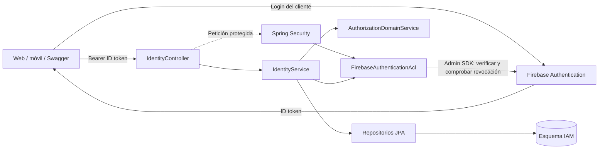

# IAM — adaptación al C4, versión 0.2.0

Decisión del usuario: **seguir al C4**, manteniendo Java/Spring Boot y el alcance de registro de cuenta/unidad e inicio de sesión.

## Fuentes

- [C4 fuente Structurizr](https://github.com/Projecto-Fundamentos/Project-Report-Fundamentos/blob/main/diagrams/structurizr/workspace-ichu-c4.dsl), componentes IAM y relaciones web/móvil → Firebase → backend.
- [Clases IAM](https://github.com/Projecto-Fundamentos/Project-Report-Fundamentos/blob/main/diagrams/puml/class-iam.puml).
- [Datos IAM](https://github.com/Projecto-Fundamentos/Project-Report-Fundamentos/blob/main/diagrams/puml/db-iam.puml).
- [Capítulo IV](https://github.com/Projecto-Fundamentos/Project-Report-Fundamentos/blob/main/chapter04.md).

## Correspondencia implementada

| Elemento del C4 | Código | Alcance |
| --- | --- | --- |
| Firebase Authentication | Admin SDK 9.11.0 | Proveedor exclusivo de identidad; firma, audiencia, emisor, expiración y revocación verificadas por SDK |
| Firebase Authentication ACL | `IdentityProvider`, `FirebaseAuthenticationAcl` | Aísla SDK y errores del proveedor de los casos de uso |
| Identity & Profile API | `IdentityController` | Registro, validación de login, identidad actual y consulta autorizada de unidad |
| Identity & Profile Application Service | `IdentityService` | Transacción local, vinculación de identidad y coordinación de autorización |
| User Account Aggregate | `Account` | UID externo, correo, rol y estado de cuenta |
| RanchMembership | `RanchMembership` | Owner/Operator, varias unidades por cuenta, revocación mediante estado activo |
| Authorization Domain Service | `AuthorizationDomainService` | Cuenta activa, rol compatible y membresía vigente de la unidad consultada |
| Identity Repository | Repositorios JPA | Cuentas, unidades y membresías bajo esquema IAM |

## Flujo de autenticación

1. El cliente crea su usuario/inicia sesión en Firebase y obtiene un ID token.
2. Envía ese token a IAM. El backend no recibe la contraseña ni firma otro token.
3. El adaptador usa `FirebaseAuth.verifyIdToken(token, true)`.
4. IAM resuelve la cuenta por UID; los permisos proceden de su base de datos.
5. `POST /auth/login` devuelve el mismo token validado y la identidad local. Se conserva la ruta solicitada como validación de entrada a IAM; no reemplaza el login de Firebase.

Este es un esquema explicativo de la adaptación, no una sustitución del workspace C4 completo del equipo.

## Migración y consistencia

V1 queda intacta. V2 añade identidad externa, rol y membresías, conserva IDs y crea membresías Owner para las unidades anteriores. Los nombres físicos `accounts` y `ranch_units` se conservan por compatibilidad, aunque el modelo fuente use `user_account` y `ranch`. `owner_id` identifica al propietario/creador, pero la autorización consulta la membresía vigente.

La identidad Firebase existe antes del registro de IAM. La transacción local cubre cuenta, unidad y membresía; no intenta incluir Firebase en una transacción JPA. Las cuentas antiguas solo se vinculan si el correo del token está verificado y coincide con la cuenta no vinculada. Las contraseñas antiguas ya no autentican.

El registro crea una cuenta en PENDING_VERIFICATION si Firebase aún no verifica el correo. Puede consultar su propia identidad; para consultar la unidad necesita correo verificado. El estado se actualiza al presentar un token nuevo que refleje la verificación.

## Diferencias y alcance pendiente

- **Tecnología/despliegue:** el DSL sigue describiendo monolito .NET. Esta entrega es un servicio Java independiente por petición del usuario. El equipo debe registrar esa variante en su C4 global; no se modificaron los repositorios remotos.
- **Perfiles y asesorías:** `ProfessionalProfile` y `HerdAdvisory` quedan fuera de los dos endpoints pedidos. Veterinarian no recibe acceso automático a unidades.
- **Gestión administrativa:** no se exponen endpoints de cambio de rol, creación/revocación de membresías ni bloqueo/desbloqueo. Las reglas de consulta admiten esos estados persistidos; su gestión requiere casos de uso posteriores.
- **Persistencia:** se conservan longitudes y nombres compatibles de V1; no se reproduce exactamente cada detalle físico del ERD.
- **Contratos con otros servicios:** los demás servicios necesitarán validar identidad y consultar permisos vigentes. No se implementaron ni se afirma que los tokens Firebase contengan todas las autorizaciones de negocio.
- **Eventos:** publicación local; sin broker/outbox durable.
- **Infraestructura:** PostgreSQL, Firebase real, emulador y Docker requieren verificación según VALIDATION.md. HTTPS debe configurarse en despliegue.

## Evidencia de calidad

La suite nueva contiene 20 casos de prueba, incluyendo rechazo entre unidades, membresías revocadas, rol incorrecto, operador autorizado explícitamente, vínculo seguro de identidad y migración V1 → V2. Las pruebas de Firebase usan dobles del proveedor/SDK y no demuestran la integración real. Las 11 pruebas aprobadas de 0.1.0 corresponden a la versión anterior con JWT local.
